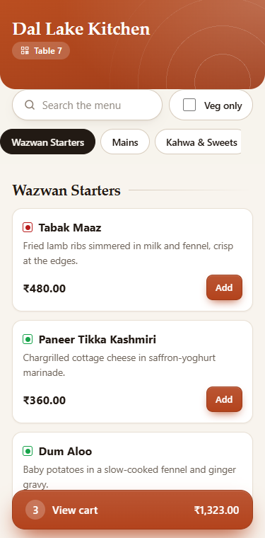
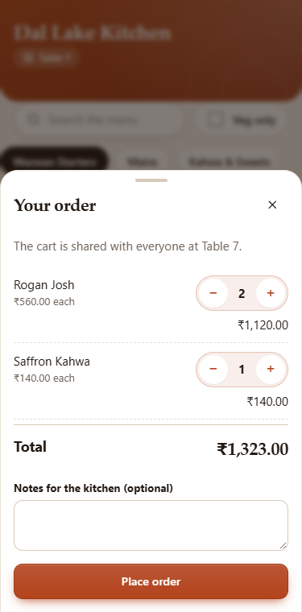
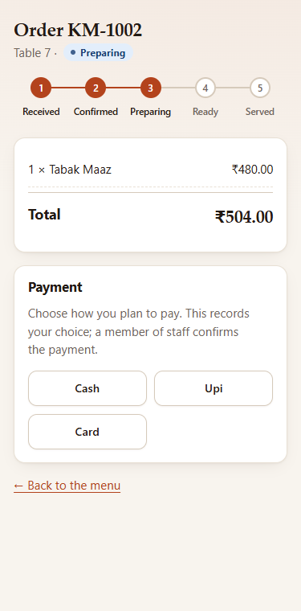
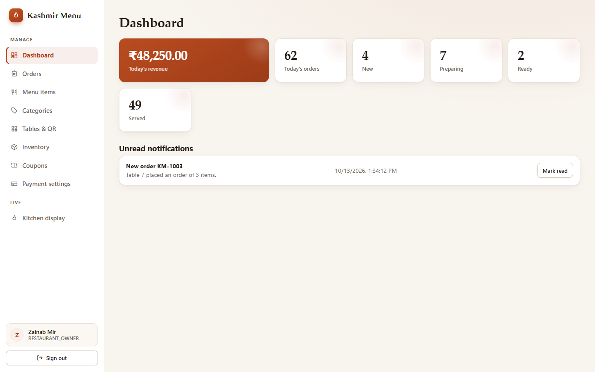
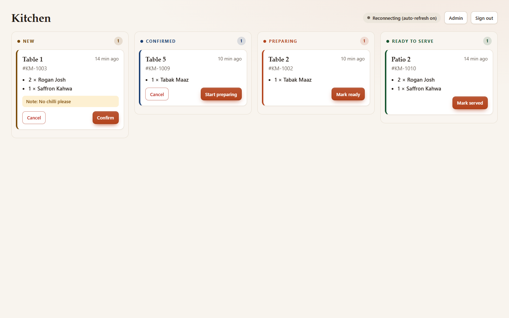
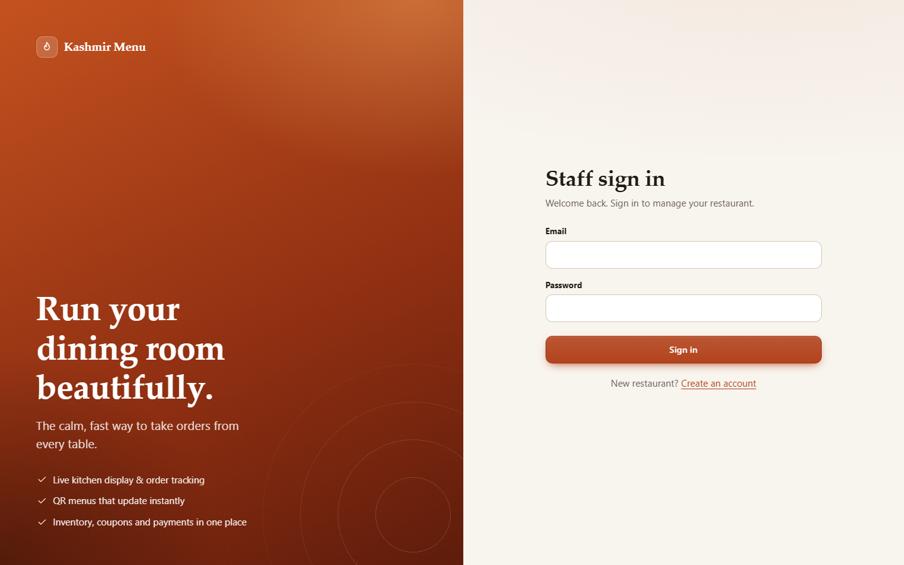

<div align="center">

# 🔥 Kashmir Menu

**Scan. Order. Track.** A multi-restaurant QR ordering platform with a live kitchen display and a calm, fast admin console.



&nbsp;

&nbsp;


<sub>Screenshots show sample data from a mock API, not a live restaurant.</sub>

</div>

---

## ✨ Highlights

| | |
|---|---|
| 📱 **QR ordering** | Diners scan a table's QR code, enter a name (no account), build their own cart and place orders. Everyone at a table has a separate cart and bill. |
| 💳 **Pay your way** | A guest pays their own bill, or one guest pays the whole table's, with a breakdown by person. Nothing counts as paid until staff confirm they have the money. |
| 🪑 **Live floor** | Owners and floor staff see every open table, who is at it, what each guest ordered and owes, confirm payments, and close or reopen tables. Paid-up tables nobody is using close themselves. |
| 👨‍🍳 **Live kitchen board** | Orders move through New → Confirmed → Preparing → Ready over a websocket, with swipeable lanes on tablets and phones. |
| 🧾 **Admin console** | Dashboard, orders, menu items, categories, tables and printable QR codes, inventory, coupons and payment settings. |
| 📦 **Stock that moves** | Placing an order takes its dishes out of inventory, and cancelling puts them back. Tracked dishes cannot be oversold: the last portion can only go to one table. |
| 🎟️ **Coupons diners can use** | Staff create codes; diners enter them on the bill and see the saving before ordering. Percentage or fixed, minimum spend, maximum discount and usage limits are all enforced. |
| 💳 **Payments & revenue** | Cash, UPI, card and wallet tracked separately, with a second level for UPI apps and wallets (Google Pay, PhonePe, Paytm UPI, Paytm Wallet, ...). Split bills, partial refunds, peak hours, a filterable payment history with CSV export, and a daily cash count. |
| 🏪 **Multi-restaurant** | Each restaurant has its own menu, tables and staff, and its own theme colour on the diner-facing menu. |
| 🔐 **Secure by default** | Stateless JWT auth, fail-fast secrets, fail-closed CORS, per-IP rate limiting, a strict Content-Security-Policy, and Swagger switched off in `prod`. |
| 🌗 **Light and dark** | A warm saffron design system that follows the device theme and respects reduced-motion settings. |

## 🖼️ A look inside

<div align="center">







</div>

## 🧱 Tech stack

| Layer | Technology |
|---|---|
| Backend | Java 21, Spring Boot 3.5, Spring Security (JWT, stateless), Spring Data JPA, MapStruct, springdoc OpenAPI |
| Database | MySQL 8 with Flyway migrations (H2 for tests) |
| Realtime | STOMP over WebSocket (`/ws`, topic `/topic/restaurants/{id}`) |
| Frontend | React 19, TypeScript, Vite 7, React Router 7, TanStack Query 5, hand-written CSS design system (no UI library) |
| Delivery | Docker, Docker Compose, nginx, GitHub Actions |

## 🗺️ Frontend routes

`/frontend` is a separate single-page app that talks to the backend over HTTP and the `/ws` websocket.

| Route | Who | What |
|---|---|---|
| `/` | Everyone | Landing page with sign-in and registration |
| `/menu/:qr` | Diners | The restaurant's landing page first, if the owner switched it on ([`docs/QR_LANDING_PAGE.md`](docs/QR_LANDING_PAGE.md)); otherwise, or after "View Menu", the menu |
| `/menu/:qr/home` | Diners | The landing page, always |
| `/menu/:qr` | Diners (no login, just a name) | Browse the menu, own cart, place an order |
| `/menu/:qr/pay` | Diners | Pay my bill or the whole table's, wait for staff to confirm, receipt |
| `/order/:token?t=:qr` | Diners | Live order status |
| `/admin/notifications` | Owner, manager, admin | Notification & sound settings ([`docs/NOTIFICATION_SOUNDS.md`](docs/NOTIFICATION_SOUNDS.md)) |
| `/platform-admin/*` | Platform owner | Dashboard, restaurant registrations (approve, reject, suspend, reactivate), settings ([`docs/RESTAURANT_APPROVAL.md`](docs/RESTAURANT_APPROVAL.md)) |
| `/login`, `/register` | Staff | Sign in, or register a restaurant (creates the owner) |
| `/admin/*` | Owner, manager, admin | Dashboard, orders, menu, categories, tables + QR, inventory, coupons, payment settings |
| `/admin/revenue` | Owner, manager, admin | Payments & revenue analytics, payment history, daily reconciliation |
| `/admin/landing` | Owner, manager, admin | QR landing page settings, rewards redemption, landing-page feedback |
| `/admin/live` | Owner, manager, admin | Live tables: payments to confirm, open tables with each guest's orders and balances, close and reopen |
| `/floor` | Waiter, cashier, owner, manager | The same live tables view for floor staff (a cashier's home page) |
| `/kitchen` | Chef, waiter, owner, manager | Live kitchen board (advance or cancel orders) and an Orders tab listing the day's orders in every status |

### How the QR flow works

Each table has a random `qrIdentifier`. Its QR code encodes `{PUBLIC_BASE_URL}/menu/{qrIdentifier}`. Scanning it and entering a name starts or joins the table's current visit and gives the guest a random secret token (`X-Diner-Token`), which is what identifies them afterwards: their cart, orders, bill and payments are theirs alone, and the table's bill shows other guests only as a name and an amount. The QR identifier alone gets a guest in; it cannot read anyone's cart. Deleting or deactivating the table stops new visits. Public write endpoints are rate limited per guest, with a much higher per-IP ceiling (a whole restaurant shares one wifi address).

Paying, closing tables, idle expiry, settings, monitoring and troubleshooting are covered in [`docs/QR_ORDERING_OPERATIONS.md`](docs/QR_ORDERING_OPERATIONS.md); the design and decisions are in [`docs/TABLE_SESSIONS.md`](docs/TABLE_SESSIONS.md).

### Design system

All styling lives in `frontend/src/styles.css`, built on CSS custom properties:

- **Tokens** for colour, type scale (fluid with `clamp()`), spacing, radii, shadows and motion.
- **Mobile first**, from 320px up. Admin navigation becomes a drawer, modals become bottom sheets, and tables become labelled cards on phones.
- **Accessible**: visible focus rings, 44px touch targets, semantic markup, and `prefers-reduced-motion` support.
- **Light and dark** via `prefers-color-scheme`.
- **Restaurant theming**: a restaurant's `primaryColor` overrides `--primary`, and all tints are derived from it.

## 🚀 Quick start

KashmirMenu is run with **Docker**. Docker Compose starts the database, the backend and the frontend together, so you don't need to install Java, MySQL or Node on your machine.

### Prerequisites

- Docker with Docker Compose

### Run it

```bash
cp .env.example .env           # then fill in real values (DB password, JWT secret, ...)
docker compose up --build
```

| Service | Address | Notes |
|---|---|---|
| Frontend | `http://localhost:3000` | nginx serves the app and proxies `/api` and `/ws` to the backend |
| Backend | `127.0.0.1:8080` | Bound to localhost only; reached through the frontend |
| MySQL | internal | Flyway runs migrations automatically on startup |

Set `PUBLIC_BASE_URL` to the address diners will actually reach, because it is baked into every printed table QR code.

<details>
<summary><b>Working on the code outside Docker</b> (contributors only)</summary>

You only need this if you are changing the code and want hot reload. It needs JDK 21, a MySQL 8 instance matching `src/main/resources/application-dev.yml` (or `DB_URL` / `DB_USERNAME` / `DB_PASSWORD`), and Node 22.

```bash
./gradlew bootRun              # backend on :8080 (dev profile)
cd frontend && npm install && npm run dev   # http://localhost:5173, proxies /api and /ws
```

</details>

### Frontend scripts (for development)

| Command | What it does |
|---|---|
| `npm run dev` | Dev server with API and websocket proxy |
| `npm run build` | Typecheck, then production bundle in `dist/` |
| `npm run typecheck` | TypeScript only |
| `npm test` | Unit tests (Vitest) |

Set `BACKEND_URL` to point the dev proxy elsewhere. For a build that calls a backend on another origin, set `VITE_API_BASE_URL` and add the frontend origin to `CORS_ALLOWED_ORIGINS`. `VITE_CURRENCY` (default `INR`) sets the display currency.

## ⚙️ Configuration

All environment-specific config lives under `src/main/resources/application-*.yml` and is driven by environment variables. Nothing environment-specific is hardcoded. See `.env.example` for the full list. Key ones:

| Variable | Purpose |
|---|---|
| `SPRING_PROFILES_ACTIVE` | `dev` or `prod` |
| `DB_URL`, `DB_USERNAME`, `DB_PASSWORD` | MySQL connection |
| `JWT_SECRET` | HMAC signing key, **must** be 32+ bytes; the app fails fast at startup otherwise |
| `JWT_ACCESS_TOKEN_EXPIRATION` | Token lifetime in ms |
| `CORS_ALLOWED_ORIGINS` | Comma-separated origins allowed to call the API and websocket. Fails closed (none allowed) if unset |
| `AUTH_RATE_LIMIT` / `AUTH_RATE_LIMIT_WINDOW_SECONDS` | Per-IP limit on `/api/v1/auth/**` |
| `PUBLIC_BASE_URL` | Frontend address encoded into table QR codes. Required in `prod` |
| `PUBLIC_RATE_LIMIT` | Per-IP limit on `/api/public/**` writes per window (default 120) |
| `TRUST_FORWARDED_HEADER` | Set `true` only behind a trusted reverse proxy that sets or strips `X-Forwarded-For` |
| `APP_TIMEZONE` | Business time zone for every day and hour boundary in the payment reports. Applied to **both** the app and the MySQL container; set it before collecting data (default `Asia/Kolkata`) |
| `APP_CURRENCY` | Currency payments are stored and reported in (default `INR`). Keep equal to the frontend's `VITE_CURRENCY` |

In `prod`, Swagger UI and `/v3/api-docs` are disabled, and `JWT_SECRET` / `CORS_ALLOWED_ORIGINS` have no defaults. The app refuses to start rather than fall back to an insecure default.

## 💳 Payments & revenue

`/admin/revenue` answers, for any period, how much came in and how people paid. Everything on the
page is derived from one aggregation query, so no two panels can disagree.

**The data model.** A payment is a *component* of an order, not a property of it. An order has as many
payment records as it needs:

```
order (₹1,200)
  ├── payment  ₹500  CASH                     SUCCESS
  └── payment  ₹700  UPI / GOOGLE_PAY         SUCCESS
                       └── refund ₹100        (payment becomes PARTIALLY_REFUNDED)
```

That is what makes the totals trustworthy: method and app totals are summed from the components, so a
split bill is never double counted, and an order's paid/outstanding figures are always derived rather
than stored. Money is `DECIMAL(10,2)` end to end and `BigDecimal` in Java; no float arithmetic touches
a financial path.

**Methods and providers are two levels.** `UPI` and `WALLET` are payment *methods*; Google Pay, PhonePe,
Paytm UPI, Paytm Wallet and the rest are *providers* under them. Paytm UPI and Paytm Wallet are
deliberately separate values. Adding a method or provider is a one-line change to `PaymentMethod` or
`PaymentProvider`: the API serves the list to the dashboard, so filters, charts and colours pick it up
with no frontend change.

**The app is never guessed.** The UPI app or wallet is recorded by staff at the moment money changes
hands (when taking payment, or when confirming the one a diner chose), because that is the only point
anyone can see it. It is never inferred from a transaction id. Payments without one are reported as
*Unknown*, including every payment that predates this feature.

**What counts as revenue.** Only captured payments (`SUCCESS`, `PARTIALLY_REFUNDED`, `REFUNDED`) are
collected revenue; pending, failed and cancelled ones are reported separately and never summed into it.
Refunds are counted on the day they are issued, and net collections are gross minus those refunds.
*Gross sales* (orders billed) is a different figure from *collections* (money received) and is shown as
such. Every metric's formula is listed under "How each figure is worked out" at the foot of the page.

**Collection is not settlement.** A card or UPI payment is collected when the diner pays and reaches the
bank later. There is no gateway or bank feed, so settlement is confirmed by a manager on the
reconciliation panel, and the two figures are shown apart.

**Access.** Taking payments is open to cashiers and waiters as well as managers; *reading* the
analytics, exporting the history and issuing refunds are restricted to owners, managers and admins.
Every query is scoped to the caller's own restaurant. Card numbers and payment credentials are never
stored - only the card *type* (credit/debit) and any reference the terminal or app supplied.

**Time.** Days and hours are the restaurant's own, from `APP_TIMEZONE`. Set it before collecting data:
changing it later re-slices history into different days.

## 🎟️ Coupons

Staff create codes under **Admin → Coupons**; diners enter them on the bill at checkout and see the
saving before they order.

A coupon lives on the **cart** while the table shops, and is copied onto the **order** when it is
placed. Both the reference and the code are stored on the order, so a past bill still shows what was
given even if the coupon is later edited or deleted.

**Checking a code never consumes it.** A use is claimed once, at the moment an order is placed, with a
single conditional `UPDATE` that only succeeds while a use remains - so a usage limit holds even if two
tables check out at the same instant. Cancelling an order releases the use. If a coupon runs out between
a diner applying it and checking out, the order still goes through at full price rather than failing.

**Two kinds of minimum, kept separate.** *Minimum order value* is an amount in 
`APP_CURRENCY`; *minimum number of dishes* is a count. A coupon can require either, both
("spend ₹500 and order at least 2 dishes") or neither - 0 means no requirement in each case.
They are different units, so they are different fields, and the admin form states the unit on
every label and reads the terms back as a sentence before saving.

**The cart re-checks the coupon on every change.** Removing an item below the minimum spend, or passing
the expiry mid-meal, drops the coupon instead of quietly discounting the bill. Codes are matched
case-insensitively because diners type them by hand, and are always scoped to the table's own
restaurant. A fixed-amount coupon worth more than the basket discounts the basket, never below zero.

All of the arithmetic lives in one pure class (`coupon/CouponPricing`), so the diner's preview, every
cart recalculation and the final order all apply exactly the same rules.

## 🕒 Order numbers and time

**Order numbers are short and per-restaurant:** `ORD-1`, `ORD-2`, `ORD-3`... Each restaurant has its
own counter, locked for the transaction so simultaneous orders take consecutive numbers. They were
previously a date plus twelve random hex characters (`ORD-20261013-290F2080CCD3`), which no diner
could read back to staff. Orders placed before this change keep their original numbers, because
diners hold them in their browser's order history.

**Timestamps are sent with the restaurant's UTC offset** (`2026-10-13T14:35:00+05:30`). They are
stored as zone-less values in the business zone, so sending them bare left the receiving browser to
assume its own zone: any device whose zone differed from the server's showed every time out by exactly
that difference, which is how a just-placed order could appear on the kitchen board as "5h 30m ago".
With the offset, a timestamp is an unambiguous instant and reads correctly from any device. Request
bodies may still send a bare local date-time.

## 🛡️ Security headers

The frontend container (nginx) sends these headers on every response, including static assets and the SPA fallback. They are defined once in [`frontend/security-headers.conf`](frontend/security-headers.conf) and included in each nginx `location`. nginx drops inherited `add_header` lines in any block that sets its own, so keep new headers in that file rather than in `nginx.conf`.

| Header | Value | Why |
|---|---|---|
| `Content-Security-Policy` | see below | Blocks injected scripts and unexpected network or resource loads |
| `X-Content-Type-Options` | `nosniff` | Stops browsers guessing a file's content type |
| `Referrer-Policy` | `strict-origin-when-cross-origin` | Limits how much of a URL is shared with other sites |
| `X-Frame-Options` | `SAMEORIGIN` | Clickjacking protection for older browsers |

```
default-src 'self'; script-src 'self'; style-src 'self';
img-src 'self' data: blob: https:; font-src 'self'; connect-src 'self';
object-src 'none'; base-uri 'self'; form-action 'self'; frame-ancestors 'self'
```

- **No inline scripts or styles.** `script-src` and `style-src` are `'self'` only, with no `'unsafe-inline'` or `'unsafe-eval'`. The app ships none, so keep it that way: no inline `<script>` tags, `eval`, or `style="..."` markup in `index.html`.
- **Images:** `https:` is allowed because restaurants enter their own logo and dish image URLs. If you serve images from one known origin or CDN, replace `https:` with it. `data:` covers icons inlined in the stylesheet and `blob:` covers the generated QR image.
- **API and websocket:** `connect-src 'self'` works because nginx proxies `/api` and `/ws` on the same origin. If you build the frontend with `VITE_API_BASE_URL` pointing at another origin, add that origin (and its `wss:` form) to `connect-src`.
- **Framing:** `frame-ancestors 'self'` replaces `X-Frame-Options` in current browsers; both are sent.
- **Not set:** `Strict-Transport-Security` is deliberately absent. Add it only once the site is served over HTTPS.

Check it after `docker compose up --build`:

```bash
curl -sI http://localhost:3000/ | grep -iE "content-security-policy|x-frame|nosniff|referrer"
```

If something is blocked in the browser, the DevTools console names the directive. To debug, temporarily rename the header to `Content-Security-Policy-Report-Only` in the snippet.

## 🩺 Operability

- **Health checks:** `GET /actuator/health/liveness` and `GET /actuator/health/readiness` (publicly reachable, used by the Docker `HEALTHCHECK` and suitable for Kubernetes probes). Other actuator endpoints are not exposed.
- **Tracing:** every request gets an `X-Request-Id` (generated if the caller doesn't send one), echoed on the response and included in log lines.
- **Shutdown:** graceful (`server.shutdown: graceful`).

## 🧪 Testing

```bash
./gradlew test               # backend, in-memory H2 (test profile)
cd frontend && npm test      # frontend unit tests

# The same integration tests against a real MySQL, with every migration applied:
docker compose -f docker-compose.test.yml up -d --wait
./gradlew mysqlTest
docker compose -f docker-compose.test.yml down -v
```

`./gradlew test` uses a Hibernate-generated schema with Flyway disabled; `src/test/resources/data.sql` seeds roles. It is fast but it is not MySQL, so it cannot show a migration that fails, an entity that disagrees with the migrated schema, or the locking and isolation behaviour the ordering and payment code depends on. `mysqlTest` runs the same tests (plus `MysqlConcurrencyIT`, which only runs there) against a throwaway MySQL; run it before releasing anything that touches those paths.

## 🔄 CI/CD

`.github/workflows/ci.yml` builds and tests on every push and PR to `main`, then builds the Docker image. It does not push the image anywhere; wire that up once you have a registry target.

## ⚠️ Known limitations

- Stock is only tracked for dishes that have an inventory row; anything else is treated as
  unlimited. There is no low-stock alert yet, and stock is not reduced for an order a manager
  creates outside the diner flow (there is no such endpoint today).
- Coupons are redeemed only when an order is placed, so a diner can try codes freely; a cancelled
  order gives the use back. There is no per-diner limit (the QR flow has no accounts), so a usage
  limit is the only cap on how often a code can be claimed.
- There is no payment gateway. A diner's payment choice creates a `PENDING` payment that staff confirm or
  reject manually, and refunds are *recorded* in the app rather than sent to a card network or UPI app -
  the money has to be moved separately. Bank settlement is likewise marked by hand.
- Payment-method analytics are only as precise as what staff select when confirming a payment. Anything
  recorded without an app or card type is reported as unknown, by design, rather than guessed.
- Migration `V18` gives every pre-existing `REFUNDED` payment one full refund record dated by the row's
  last update, which is the only information available. Review those rows if exact refund dates matter
  for a historical period.
- The CSV export is capped at 50,000 rows per download and is built in memory.
- The websocket (`/topic/restaurants/{id}`) is not authenticated, so anyone who knows a restaurant id can subscribe to its notification messages.
- The coupon, notification and inventory endpoints have not had a full authorization audit (no role guards; coupons and notifications take `restaurantId` from the client).
- There is no staff-creation endpoint, so chef, waiter and manager accounts cannot be created through the API yet.
- The frontend is type-checked, unit-tested and built. Its layouts were reviewed visually in a browser against a mock API, and a Lighthouse run on the production build scored 99–100 for performance, accessibility and best practices (mobile and desktop). It has not been exercised end to end against a running backend, on real devices, or through the Docker/nginx image.
- The Docker images have not been built in this environment, so the nginx security headers (including the CSP) were tested in a browser via a stand-in server, not through the real nginx image.
- The auth rate limiter (`AuthRateLimitFilter`) is in-memory and per-instance; behind multiple app instances it won't share state. Put a gateway or edge rate limiter in front for real abuse protection at scale.

## 📄 More

- [`CHANGES.txt`](CHANGES.txt): detailed change log.
- Interactive API docs (non-prod): `/swagger-ui.html`.
